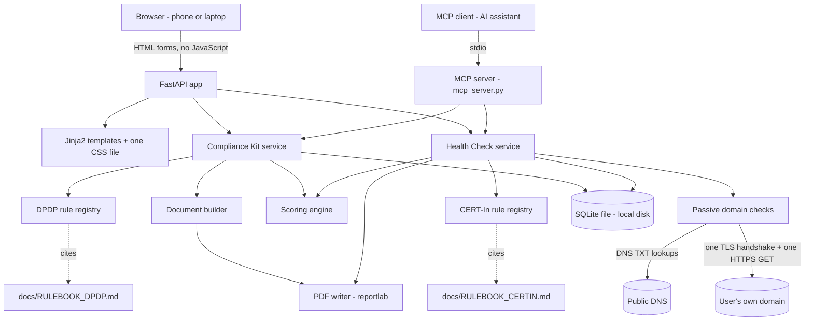

# Wolftech Shield Suite - Specification

Wolftech AI Labs, Ahmedabad. Version 0.1, 11 November 2026.

Two products in one local web app:

- **A. Compliance Kit** - gets a small Indian firm ready for the DPDP Act 2023
  and DPDP Rules 2025. First profile: Law firm.
- **B. Cyber Health Check** - a scored security check mapped to the CERT-In
  Directions of 28 April 2022 and CERT-In's 15 MSME controls.

Rule sources: `docs/RULEBOOK_DPDP.md` and `docs/RULEBOOK_CERTIN.md`.

## 1. User journeys

### 1.1 Compliance Kit (managing partner or office manager of a small law firm)

1. Opens the app on a phone or laptop. Sees two choices: open the demo workspace
   ("Sample Law Associates") or start a new workspace.
2. **Onboarding.** Enters firm name, city, staff count, a privacy contact, and
   answers three profile questions (website? outside vendors handling data?
   data about under-18s?).
3. **Data inventory.** For each of five record types (client files, KYC
   documents, employee data, visitor records, vendor contracts) says whether it
   is held, in what form, why, where it is stored, how long it is kept and who
   it is shared with.
4. **Gap assessment.** Answers one plain-English question per rule
   (Yes / Partly / No / Not applicable).
5. **Dashboard.** Sees a readiness score, days left to each legal date, and a
   prioritised gap list. Each gap shows the rule ID, the section or rule number
   and a link to the source.
6. **Documents.** Downloads six draft documents as branded PDFs, filled with the
   firm's own inventory.
7. Hands the PDFs to a lawyer for review.

### 1.2 Cyber Health Check (same person, or the firm's IT helper)

1. From the workspace, opens Cyber Health Check.
2. Answers the security questionnaire (backups, passwords and MFA, patching,
   email security, staff training, incident plan, logs and devices).
3. Optionally enters the firm's domain, ticks "I confirm I own or control this
   domain", and runs the passive checks.
4. Sees a score, a grade, and fixes ranked easiest first.
5. Downloads the PDF report.

### 1.3 AI assistant (through MCP)

An MCP client calls `assess_readiness`, `list_gaps`, `generate_document` or
`run_health_check` against a local workspace.

## 2. MVP scope

In scope:

- One firm profile: Law firm. Five inventory categories.
- 29 scored DPDP rules, 25 scored CERT-In rules (see rule books).
- Six generated documents: privacy notice, consent text, data retention
  schedule, breach response plan, processor contract checklist, grievance
  procedure.
- Deadline tracker from the three verified commencement dates.
- Passive domain checks: SPF, DMARC, DKIM (common selectors), TLS certificate,
  HTTP security headers.
- PDF export for every document and for the health report.
- Seeded fictional demo workspace.
- MCP server with four tools.

## 3. Data model (SQLite via SQLModel)

### firm
| Field | Type | Notes |
|---|---|---|
| id | int PK | |
| name | str | |
| profile | str | `law_firm` |
| city | str | |
| staff_count | int | |
| contact_name | str | person who answers data questions |
| contact_email | str | |
| contact_phone | str | |
| website | str | may be empty |
| has_website | bool | profile flag |
| uses_processors | bool | profile flag |
| handles_children | bool | profile flag; switches the children rules on |
| is_demo | bool | demo workspace is read-only for reset |
| created_at | datetime | |

### inventoryitem
| Field | Type | Notes |
|---|---|---|
| id | int PK | |
| firm_id | int FK firm | |
| category | str | `client_files`, `kyc_documents`, `employee_data`, `visitor_records`, `vendor_contracts` |
| held | bool | |
| data_items | str | what personal data is in it |
| purpose | str | why it is kept |
| basis | str | `consent`, `voluntary`, `employment`, `legal_duty`, `unsure` |
| storage | str | where it lives |
| retention | str | how long it is kept, in the firm's words |
| shared_with | str | vendors or others |

### answer
| Field | Type | Notes |
|---|---|---|
| id | int PK | |
| firm_id | int FK firm | |
| product | str | `dpdp` or `health` |
| question_id | str | |
| value | str | `yes`, `partial`, `no`, `na`, or empty (unanswered) |
| updated_at | datetime | |

### domaincheck
| Field | Type | Notes |
|---|---|---|
| id | int PK | |
| firm_id | int FK firm | |
| domain | str | |
| ownership_confirmed | bool | must be true or the check is refused |
| run_at | datetime | |
| results_json | str | list of findings |

Rules and questions are code, not tables (`app/rules/`), so they are versioned
with the rule books and covered by tests.

## 4. Architecture



Layout:

```
app/
  main.py            app factory, home, static, security headers
  db.py  models.py   engine, session, tables
  rules/             base.py, dpdp.py, certin.py   (rules + questions)
  scoring.py         one scoring engine for both products
  compliance/        routes.py, documents.py, deadlines.py, service.py
  health/            routes.py, domain_checks.py, service.py
  pdf.py             branded PDF writer
  seed.py            fictional demo workspace
  templates/ static/
mcp_server.py
tests/
```

Technology: Python only. FastAPI, Jinja2, SQLModel on SQLite, reportlab,
dnspython, httpx, pytest. No JavaScript. No external fonts, scripts or
analytics.

## 5. Scoring method

Each question maps to exactly one scored rule. Each rule has a weight.

| Answer | Value |
|---|---|
| Yes | 1.0 |
| Partly | 0.5 |
| No | 0.0 |
| Not answered | 0.0 (counts as a gap, shown as "not answered") |
| Not applicable | left out of the score |

```
score = 100 x sum(weight x value) / sum(weight of applicable rules)
```

Rounded to a whole number. If nothing is applicable the score is shown as "-".

**Weights are Wolftech's prioritisation, not law.** They follow the penalty
tiers in the Act's Schedule so that the gaps with the highest legal exposure
come first:

| Weight | DPDP rules | Reason |
|---|---|---|
| 3 | Security safeguards (S01-S05), breach notices (B01, B02), children (CH01, CH02) | Named in Schedule items 1-3 (up to Rs 250 / 200 crore) |
| 2 | Notice, consent, erasure, grievance, rights, processor contract | Schedule item 7 (up to Rs 50 crore), core day-to-day duties |
| 1 | Supporting duties (language option, nomination, accuracy) | Same tier, lower effort and exposure for a small firm |

Health Check weights: 3 for the mandatory Directions (D1-D4) and for the
controls that stop the most common attacks on small firms (MFA, backups,
patching); 2 for the rest. Each health fix also carries an effort label (Low,
Medium, High - Wolftech's estimate) and the fix list is sorted by effort first,
then weight.

Bands: 80-100 "Strong", 50-79 "Getting there", 0-49 "Needs attention".

Conditional rules: children rules (CH01, CH02) are applicable only if the firm
says it holds data about under-18s; processor rules (P01-P03) only if it uses
outside vendors; website-dependent wording adapts but the rules stay applicable.

Domain checks: SPF and DMARC results feed rule CERTIN-NES.4 (a failing DNS
check caps the questionnaire answer for that rule at "Partly"). TLS and header
findings are shown but never scored, because no primary-source rule requires
them (see RULEBOOK_CERTIN.md section 5).

Gap priority (Compliance Kit): weight high to low, then "No" before "Partly".

## 6. Threat model

Assets: the firm's answers and inventory (business-sensitive, low personal-data
content), generated documents, the SQLite file.

| Threat | Mitigation |
|---|---|
| Data leaves the machine | No analytics, no third-party scripts, fonts or CDNs. The only outbound traffic is the domain check the user starts. Strict Content-Security-Policy (`default-src 'self'`). |
| Tool misused to probe someone else's domain | Explicit ownership confirmation required and stored; checks are passive (public DNS, one TLS handshake, one GET); no port scan, no path guessing, no login attempts; domain syntax validated; IP addresses, localhost and private names refused; no redirects followed off-domain; short timeouts. |
| Server-side request forgery through the domain field | Only a bare hostname is accepted; resolved addresses that are private, loopback or link-local are refused. |
| Cross-site scripting through firm-entered text | Jinja2 autoescape on; no `safe` filter on user input; PDF text escaped before reportlab markup. |
| Cross-site request forgery | App is local-first with no login in the MVP. `SameSite` is moot without cookies; state-changing routes are POST only. Hosted deployment must add authentication (out of scope, flagged in README). |
| SQL injection | SQLModel parameterised queries only. |
| Invented or stale legal content | Rules live in code with citations; a test fails if a scored rule is missing from the rule book or is not VERIFIED; every document carries the lawyer-review line. |
| Demo shows real people | Seed data is fictional; `.example` domains only. |
| Hosted demo exposes entered data to other visitors | README warns: the Render deployment is a demo, has no login, and must hold fictional data only. |
| Dependency risk | Small pinned dependency list; no JS toolchain. |

## 7. Test plan

Run with `pytest`.

| Area | Tests |
|---|---|
| Rule books | Every scored rule ID in code appears in the matching rule book with status VERIFIED and "Scored: Yes"; every scored rule has a citation and an https source URL. |
| Coverage of scoring | One parametrised test per scored rule: answering its question "no" produces a gap citing that rule, "yes" removes the gap and raises the score. Every scored rule has exactly one question. |
| Scoring engine | All yes = 100; all no = 0; partial = half; N/A excluded; conditional rules switch on and off with profile flags; unanswered counts as gap. |
| Deadlines | The three dates equal the rule book; day counts and past/upcoming status are right for fixed test dates. |
| Documents | Each of the six documents builds for the demo firm, contains the disclaimer, the firm name and its cited rules; PDF bytes start with `%PDF` and the disclaimer text is extractable from the PDF. |
| Domain checks | SPF/DMARC/DKIM parsing with a fake resolver; header grading with fake headers; refusal without ownership confirmation; refusal of IPs, localhost, private names. No test touches the network. |
| Web journey | With FastAPI TestClient: home, create firm, save inventory, save answers, dashboard, gap list, each document page and PDF, health questionnaire, health report and PDF; security headers present; no `<script` and no external URLs loaded in any page. |
| Demo seed | Demo workspace exists, is fictional, and gives a mid-range score with gaps. |
| MCP | The four tools are registered and return structured results for the demo firm. |

Manual gate: start the app and walk the demo journey end to end in a browser.

## 8. Out of scope

- Legal advice, and any claim that a firm "is compliant".
- User accounts, roles, multi-tenant hosting, encryption at rest of the SQLite
  file (use disk encryption on the machine).
- Consent Manager integration, Significant Data Fiduciary duties (DPIA, audit).
- Cross-border transfer analysis.
- Profiles other than Law firm (clinics, CAs, schools) - planned next.
- Languages other than English in the UI and documents.
- Active security testing: port scans, vulnerability scans, password tests,
  phishing simulations.
- Automatic filing with the Data Protection Board or CERT-In.
- Ongoing monitoring and reminders.
